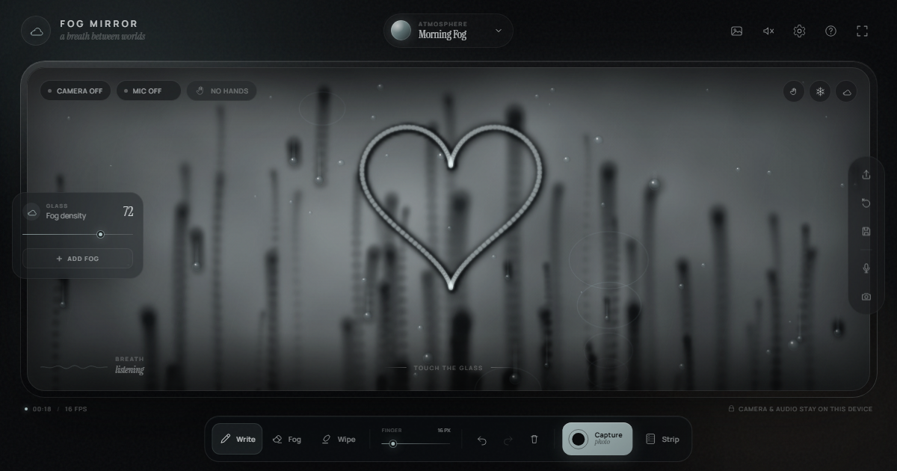
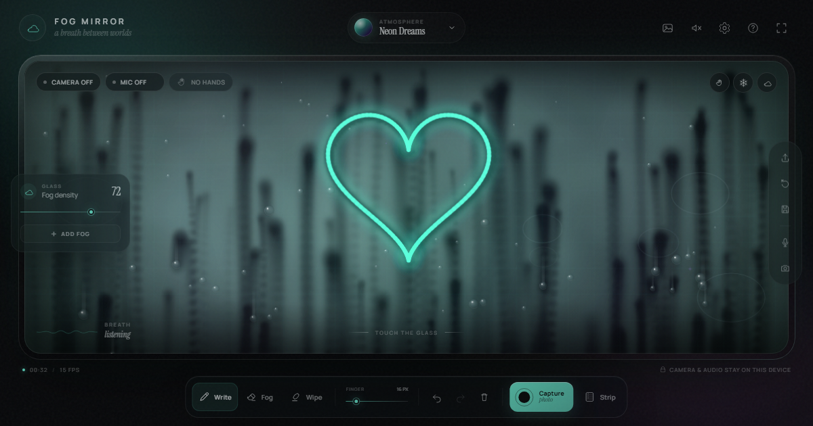
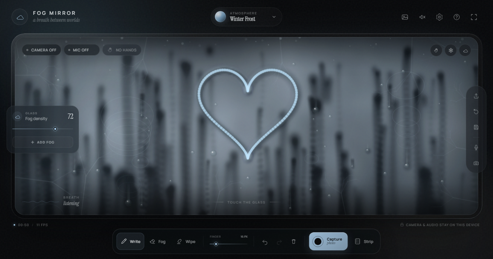
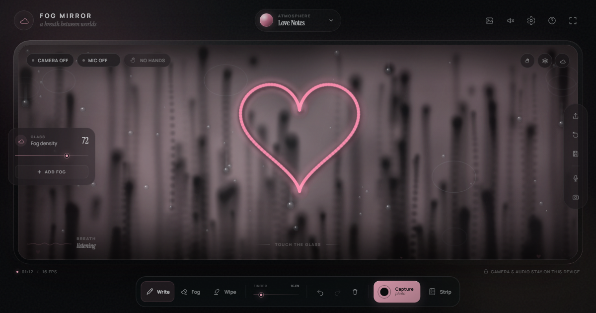
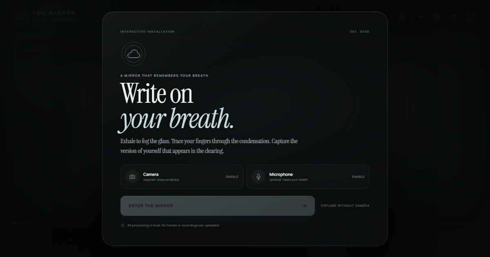

# FOG MIRROR

[](https://github.com/ajaybe-ops/fog-mirror/actions/workflows/ci.yml)
[](https://github.com/ajaybe-ops/fog-mirror/actions/workflows/pages.yml)
[](LICENSE)
[](#privacy)

**Live:** https://ajaybe-ops.github.io/fog-mirror/

A browser-based interactive installation: a fogged bathroom mirror you can write on with your fingertip, clear with your palm, fog with your breath, and photograph. Everything runs locally in the browser — no frames, audio, or photographs are uploaded.



| Morning Fog | Neon Dreams |
| --- | --- |
|  |  |
| **Winter Frost** | **Love Notes** |
|  |  |

The screenshots above are captures of the running app (without a camera attached), not mockups. Fog, droplets, the drawn stroke, and the interface are all live canvas output.

## Run it

The app is plain HTML/CSS/ES modules and needs no build step, but it must be served over HTTP (module imports and `getUserMedia` do not work from `file://`).

```bash
npm start
# FOG MIRROR → http://127.0.0.1:8765
```

`npm start` runs a zero-dependency Node static server. Any static server works (`python -m http.server 8765`, `npx serve`, nginx, …). Use `localhost` or HTTPS so the browser allows camera and microphone access.

### Verify

```bash
npm run check
```

The checker parses every module, resolves every relative import, validates HTML ids and ARIA references, checks DOM lookups, confirms CSS brace balance and local assets, and verifies every `src/` module is reachable from the page. CI runs it on Node 22 and smoke-tests the static server.

Latest Lighthouse audit of the local build (Chromium): **Accessibility 100 · Best Practices 100 · SEO 100**.

### First run

1. Choose **Enable** next to Camera (required for the live reflection and hand tracking).
2. Optionally enable the Microphone for breath-controlled fog.
3. Press **Enter the mirror**, or **Explore without camera** to draw with a mouse/touch.

If a permission is denied, the app explains what happened and keeps working with pointer input and manual fog. It never substitutes a fake camera feed.



## What it does

### Fog and breath
- Low-resolution density field simulated at up to 560 columns, upscaled with animated fractal noise for a soft, photographic condensation texture.
- Breath detection is calibrated against the room's noise floor for ~1.8 s, then scores broadband energy, spectral flatness, high-frequency ratio, and zero-crossing rate. Loud speech or music is rejected; a soft exhale is accepted.
- Fog evaporates, diffuses, auto-refogs, and can be frozen. Droplets spawn in dense areas, grow, merge, and run down the glass leaving clear trails.

### Writing and wiping
- Pinch (thumb + index) writes; the fingertip clears fog and leaves a wet or themed pigment line.
- Open palm wipes a wide window. A circle gesture dissolves a round porthole.
- Mouse, pen, and touch drawing work everywhere, including without a camera.
- Undo/redo restores matching fog snapshots, so the glass itself rewinds. Save and restore drawings locally.

### Gestures
| Gesture | Action |
| --- | --- |
| Pinch (thumb + index) | Write / draw |
| Open palm | Wipe a wide clearing |
| Fist | Freeze or release the fog |
| Peace sign | Toggle selfie mode |
| Thumbs up | Start the photo countdown |
| Swipe left / right | Previous / next atmosphere |
| Circle in the air | Clear a round window |
| Two hands apart / together | Widen / narrow the brush |

Static poses require several consecutive frames; discrete actions have cooldowns; pinch and wipe use hysteresis so a dropped inference frame does not break a stroke.

### Atmosphères
Morning Fog, Love Notes, Winter Frost, Neon Dreams, Rainy Window, Mystery Mirror, Mirror Art, and Reflection. Each theme changes the fog colour, ink, particles, ambient tint, camera grade, and a painterly overlay (hearts, frost ferns, neon grid, rain bokeh, constellations, pigment blooms).

### Photo booth
- Real composited captures: live mirrored video + secret layer + fog + theme + droplets + drawing + particles.
- Three-second countdown, flash, optional face-aware framing using MediaPipe face detection.
- Five filters (Natural, Noir, Vintage, Neon, Dream), single photos and four-frame strips.
- Photos are encoded as JPEG/PNG, stored in IndexedDB, and can be downloaded or deleted. A separate **Export artwork** action saves the current mirror as a PNG.

### Accessibility and comfort
- Full keyboard control, focus-visible states, ARIA labels/live regions, and a skip/explore path without a camera.
- Reduced-motion setting disables drifting particles, rain, and heavy animation.
- Touch targets and layouts adapt from wide desktop to narrow phones.

## Keyboard shortcuts

| Key | Action |
| --- | --- |
| `W` / `E` / `B` | Write / erase / wipe tool |
| `Ctrl/Cmd + Z` | Undo |
| `Ctrl/Cmd + Shift + Z` | Redo |
| `P` | Capture photo |
| `G` | Photo gallery |
| `T` | Atmosphere panel |
| `H` | Hand overlay |
| `F` | Freeze fog |
| `Shift + F` | Fullscreen |
| `M` | Enable microphone |
| `A` | Ambient sound |
| `S` / `R` | Save / restore drawing |
| `X` | Export artwork |
| `1`–`8` | Select atmosphere |
| `?` | Gesture tutorial |
| `Esc` | Close panel / tutorial |

## Architecture

```
fog-mirror/
├── index.html                  entry gate, mirror, panels, canvases
├── 404.html                    themed not-found page
├── styles.css                  visual system, responsive layout, tutorial poses
├── favicon.svg                 app mark
├── manifest.webmanifest        installable web app metadata
├── og.png                      social preview (real app capture)
├── assets/                     real captures of the running app
├── src/
│   ├── main.js                 orchestration, render loop, event wiring
│   ├── config.js               themes, thresholds, model URLs, defaults
│   ├── utils.js                emitter, math, noise, canvas helpers
│   ├── storage.js              localStorage preferences + IndexedDB photos/drawings
│   ├── camera.js               getUserMedia lifecycle and cover/mirror mapping
│   ├── audio-engine.js         mic calibration, breath scoring, ambient drone
│   ├── fog-engine.js           density simulation, clearing, rendering
│   ├── vision.js               shared MediaPipe Tasks Vision loader
│   ├── hand-tracking.js        HandLandmarker inference, smoothing, overlay
│   ├── gesture-recognition.js  temporal gesture logic and cooldowns
│   ├── face-detection.js       lazy BlazeFace detector for framing
│   ├── particle-engine.js      mist, hearts, snow, sparks, rain, stars, pigment
│   ├── droplet-engine.js       condensation beads, merging, falling trails
│   ├── drawing-engine.js       strokes, undo/redo, fog snapshots, persistence
│   ├── photo-booth.js          compositing, countdown, filters, strips, export
│   ├── gallery.js              IndexedDB gallery UI, download, delete
│   ├── theme-manager.js        theme state and cached canvas overlays
│   └── ui-controller.js        DOM, panels, tutorial, keyboard, statuses
├── tools/
│   ├── serve.mjs               zero-dependency local static server
│   └── check.mjs               syntax/import/HTML/CSS/reachability checker
└── .github/workflows/
    ├── ci.yml                  checks + static-server smoke test on Node 22
    └── pages.yml               deploys the static site to GitHub Pages
```

- **No backend, no analytics, no network storage.** Preferences use `localStorage`; photographs and the last drawing use IndexedDB.
- **Canvas 2D throughout.** The fog is a Float32 density field sampled into a small ImageData canvas and upscaled; each visual layer is its own canvas so compositing and photo capture stay simple.
- **MediaPipe is loaded lazily** from jsDelivr (`@mediapipe/tasks-vision@0.10.21`, native `vision_bundle.mjs`) and models from Google's model storage. If the CDN or GPU is unavailable, hand tracking reports an error and pointer drawing still works. Face detection falls back to CPU and is optional.
- **Zero runtime dependencies.** No framework, bundler, or package install is required to run the app.

## Deploy

Pushing to `main` runs CI and deploys the site to GitHub Pages. The Pages workflow stages only the public files (`index.html`, `404.html`, `styles.css`, `src/`, icons, manifest, `og.png`, `robots.txt`, `sitemap.xml`) so repository internals are never published.

To enable it on a fork: **Settings → Pages → Build and deployment → Source: GitHub Actions**, then push to `main`.

## Browser support

Tested in current Chromium. Requires:
- ES modules and Canvas 2D
- `getUserMedia` for camera/microphone
- IndexedDB for the photo archive (the app still runs if storage is blocked)
- Web Audio for breath analysis and ambient sound

## Privacy

Camera frames and microphone samples are processed in the page and never transmitted. Photographs, drawings, and settings stay on the device until you delete them (**Settings → Clear all local photos & drawings**). Clearing site data also removes them.

## License

MIT © 2026 [Ajay Krishna](https://github.com/ajaybe-ops). See [LICENSE](LICENSE).

The MediaPipe runtime and models are loaded from their respective CDNs and remain under their own licenses.
